<p align="center">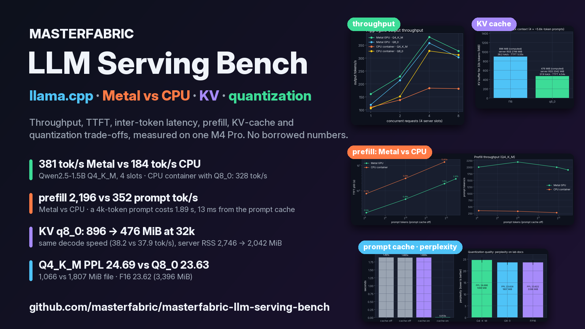</p>

# MasterFabric · LLM Serving Bench

Measured LLM serving benchmarks on servers that actually ran: aggregate throughput, time to first token
(TTFT) and inter-token latency (ITL) against concurrency, prefill cost against prompt length,
weight quantization (Q4_K_M, Q8_0, F16), KV-cache quantization and prompt-cache reuse.
llama.cpp on the Apple M4 Pro GPU (Metal) is compared with the same server in a CPU-only container
and with Apple's MLX engine; the main runs are repeated on a MacBook Air M5. A long-context curve (512 to 31k tokens) measures memory and speed as the
context grows, and speculative decoding with a 0.5B draft model is measured on 1.5B and 7B targets.

Every number in this README comes from a file in [`results/`](results/), written by the scripts in
[`bench/`](bench/). Values that are computed rather than measured say so.

> Part of the MasterFabric data and AI portfolio. The serving defaults chosen here feed
> [masterfabric-onprem-llm-stack](https://github.com/masterfabric/masterfabric-onprem-llm-stack).

## Contents

- [Key results](#key-results) · [Setup](#setup) · [Results](#results) · [MLX vs llama.cpp](#mlx-vs-llamacpp-on-the-same-gpu) ·
  [Long context](#long-context-512-to-31k-tokens) · [Speculative decoding](#speculative-decoding) ·
  [Why draft output differs](#why-speculative-output-differs-from-the-target-alone) · [MacBook Air M5](#macbook-air-m5-vs-m4-pro) · [Decisions (ADRs)](#decisions)
- [Enterprise mapping](#enterprise-mapping) · [Quickstart](#quickstart) · [Limitations](#limitations) · [Roadmap](#roadmap)

## Key results

| | Metal GPU (host) | CPU container (6 vCPU) |
|---|---|---|
| Peak output throughput, Q4_K_M (4 concurrent) | **381 tok/s** | 184 tok/s |
| Peak output throughput, Q8_0 (4 concurrent) | 358 tok/s | **328 tok/s** |
| Single-stream decode, Q4_K_M (ITL p50) | 5.9 ms/token (161 tok/s) | 8.6 ms/token (110 tok/s) |
| Prefill, Q4_K_M, ~1k-token prompt | 2,196 prompt tok/s | 330 prompt tok/s |
| TTFT for a 3.8k-token prompt, cold | 1.91 s | 13.83 s |

- **Concurrency should equal the slot count.** With 4 slots, throughput peaks at 4 concurrent
  requests; at 8, half the requests wait for a slot and TTFT p50 jumps from ~14 ms to 1.5-2.9 s.
- **Q8_0 is the better CPU format on this machine.** 328 vs 184 tok/s at 4 concurrent, reproduced in a
  second run (335 vs 181). On Metal, Q4_K_M is slightly faster.
- **Q4_K_M costs little quality.** Perplexity 24.69 ± 1.09 vs 23.63 ± 1.04 for Q8_0 (F16: 23.62 ± 1.04, so Q8_0 is indistinguishable from F16),
  for a 41% smaller file.
- **A q8_0 KV cache halves KV memory at the same speed.** At 32k context: 896 → 476 MiB KV buffer
  (computed), server RSS 2,746 → 2,042 MiB (measured), 38.2 vs 37.9 tok/s.
- **MLX is faster at 4-bit, but its 4-bit loses more quality.** One request: 210 vs 171 tok/s; server
  peak 474 vs 378 tok/s. Perplexity rises 17.5% over MLX's own 8-bit, against 4.5% for Q4_K_M. At
  8-bit the engines are within 5-10% for one request.
- **Long context costs memory and speed.** From 512 to 31,744 prompt tokens, llama.cpp's peak
  footprint grows 1.40 → 2.25 GiB (1.85 GiB with a q8_0 KV cache) and decode falls 171 → 96 tok/s.
  MLX stays faster (114 tok/s at 31k) but peaks at 3.40 GiB; its 8-bit KV cache raised memory to 5.14 GiB.
- **Speculative decoding pays off only for a big target on predictable text.** 7B + 0.5B draft:
  1.60x (llama.cpp) and 1.73x (MLX) on code/SQL/YAML, 0.41-0.49x on open text with 16 draft tokens.
  On the 1.5B target it is always slower (0.31-0.71x).
- **Draft output differs from the target alone because of near-ties, not a bug.** Every one of the
  5 divergences (7B, of 8 prompts) happened where the target's own top two tokens were within
  0.002-0.034 nats (median gap over all tokens: 5.36), and the target alone was deterministic (8/8
  identical repeats). Feeding the target the same prefix as one batch, with no draft model, picks
  the draft run's token in 3 of 5 cases.
- **A MacBook Air M5 decodes at 0.57-0.75x the M4 Pro** with llama.cpp (one and four requests,
  Q4_K_M and Q8_0), but prefills short prompts faster (2,753 vs 2,196 prompt tok/s at ~1k tokens) and
  long prompts slower (1,638 vs 1,999 at 3.8k). Measured on battery.
- **The prompt cache turns a 1.89 s prefill into 13 ms** for a repeated 4k-token prompt, and costs
  nothing on the cold request (1.888 s vs 1.891 s).

## Setup

<p align="center">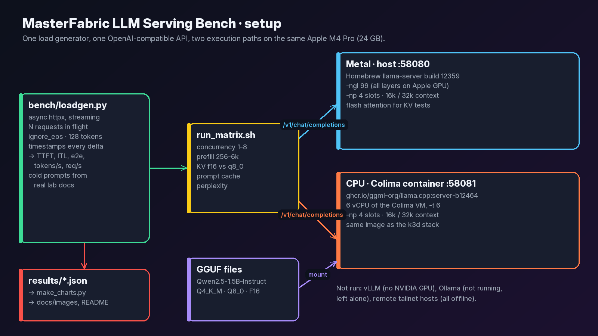</p>
<p align="center"><sub><b>Figure 1.</b> One load generator, OpenAI-compatible APIs and three execution paths on the same laptop: llama.cpp on Metal, MLX on Metal, llama.cpp on CPU.</sub></p>

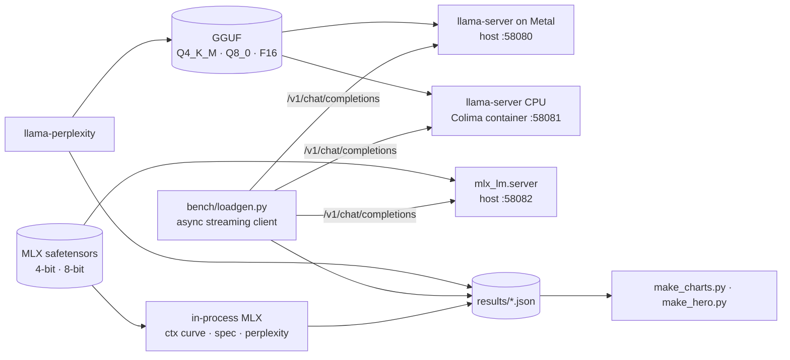

| | |
|---|---|
| Machine | Apple M4 Pro, 14 cores, 24 GB unified memory, macOS 27.2.1 |
| Metal server | Homebrew llama.cpp 1.0.0 (build 12359), `-ngl 99 -np 4 -c 16384` |
| CPU server | `ghcr.io/ggml-org/llama.cpp:server-b12464` in Colima (6 vCPU, 10 GB), `-t 6 -np 4 -c 16384` |
| Model | Qwen2.5-1.5B-Instruct GGUF (Q4_K_M 1,066 MiB, Q8_0 1,807 MiB, F16 3,396 MiB) |
| Client | [`bench/loadgen.py`](bench/loadgen.py): httpx, streaming, `ignore_eos`, 128 output tokens, temperature 0 |
| MLX | mlx 0.32.4, mlx-lm 0.32.2 (`requirements-mlx.txt`); `mlx_lm.server` on 127.0.0.1:58082, started and stopped by `bench/run_mlx.sh` (the user's own MLX server on :11234 is not touched) |
| Extra models | Qwen2.5-1.5B MLX 4-bit (828 MiB) / 8-bit (1,564 MiB); Qwen2.5-7B Q4_K_M (4,466 MiB) / MLX 4-bit; Qwen2.5-0.5B Q8_0 / MLX 8-bit as draft |

How each metric is measured, and what was not controlled, is in [ADR 0002](docs/adr/0002-methodology.md).

## Results

### Throughput and latency against concurrency

<p align="center">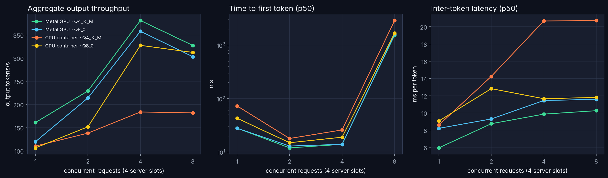</p>
<p align="center"><sub><b>Figure 2.</b> 1, 2, 4 and 8 concurrent requests against 4 server slots. Short (~48-token) prompts, so TTFT here measures queueing, not prefill.</sub></p>

| Backend · weights | 1 | 2 | 4 | 8 | ITL p50 at 4 | TTFT p50 at 8 |
|---|---|---|---|---|---|---|
| Metal · Q4_K_M | 161 | 229 | **381** | 327 | 9.9 ms | 1.53 s |
| Metal · Q8_0 | 120 | 214 | 358 | 303 | 11.4 ms | 1.59 s |
| CPU · Q4_K_M | 110 | 138 | 184 | 182 | 20.7 ms | 2.88 s |
| CPU · Q8_0 | 106 | 152 | 328 | 312 | 11.7 ms | 1.68 s |

Output tokens/s, summed over all requests in flight. Files: `results/concurrency_*.json`, repeat run in `results/repeat_cpu.json`.

### Prefill cost against prompt length

<p align="center">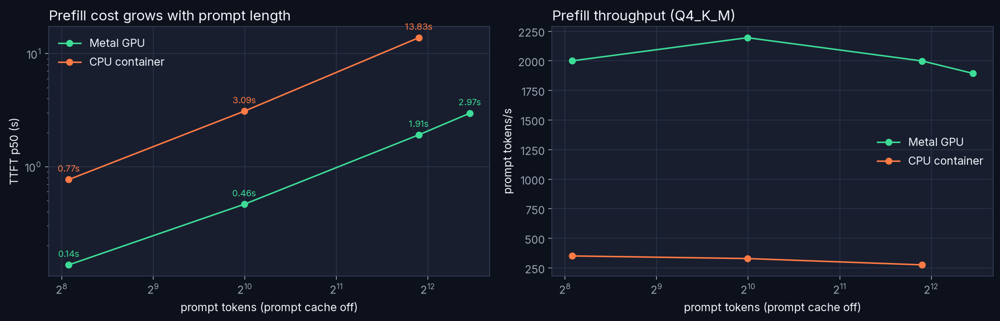</p>
<p align="center"><sub><b>Figure 3.</b> Cold prompts cut from real documentation, prompt cache off, Q4_K_M, 32k context.</sub></p>

| Prompt tokens | Metal TTFT | Metal prefill | CPU TTFT | CPU prefill |
|---|---|---|---|---|
| 270 | 0.135 s | 2,000 tok/s | 0.768 s | 352 tok/s |
| 1,019 | 0.464 s | 2,196 tok/s | 3.091 s | 330 tok/s |
| 3,820 | 1.911 s | 1,999 tok/s | 13.834 s | 276 tok/s |
| 5,621 | 2.968 s | 1,894 tok/s | not run | |

The GPU prefills 6-7× faster than the CPU container, and the gap grows with the prompt: CPU prefill
slows down as attention over a longer context starts to dominate. For RAG with 4k-token contexts, a
CPU-only node adds ~14 s before the first token. File: `results/prefill.json`.

### KV cache, prompt cache and quantization quality

<p align="center">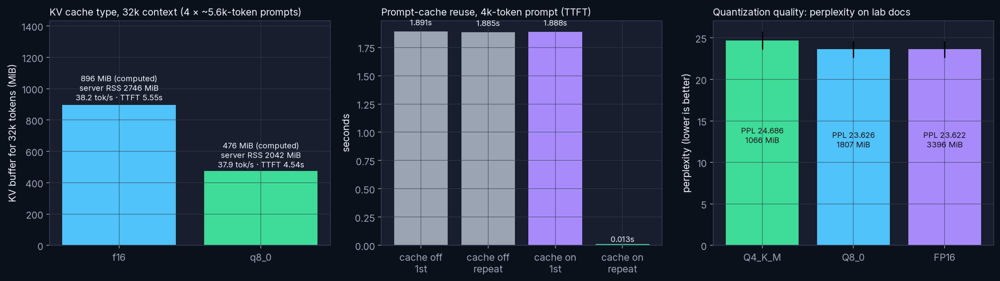</p>
<p align="center"><sub><b>Figure 4.</b> Left: f16 vs q8_0 KV cache. Middle: TTFT for a repeated 4k-token prompt. Right: perplexity on 38 KB of lab documentation.</sub></p>

| KV cache type (32k ctx, flash attention) | KV buffer (computed) | Server RSS (measured) | Output tok/s | TTFT p50 | ITL p50 |
|---|---|---|---|---|---|
| f16 | 896 MiB | 2,746 MiB | 38.2 | 5.55 s | 13.7 ms |
| q8_0 | 476 MiB | 2,042 MiB | 37.9 | 4.54 s | 13.6 ms |

The KV buffer is computed from the model shape: 28 layers × 2 KV heads × 128 dims × (K + V) =
14,336 values per token, × 32,768 tokens × 2 bytes (f16) or 34/32 bytes (q8_0). The quiet server
log did not print buffer sizes, so the measured figure is the server's resident memory after the run.

| Prompt cache | 1st request TTFT | Repeat TTFT |
|---|---|---|
| off (`cache_prompt: false`) | 1.891 s | 1.885 s |
| on (default) | 1.888 s | **0.013 s** |

| Weights | File | Perplexity (ctx 512) |
|---|---|---|
| Q4_K_M | 1,066 MiB | 24.69 ± 1.09 |
| Q8_0 | 1,807 MiB | 23.63 ± 1.04 |
| F16 | 3,396 MiB | 23.62 ± 1.04 |

Files: `results/kvcache.json`, `results/promptcache.json`, `results/perplexity.json`.

### MLX vs llama.cpp on the same GPU

<p align="center">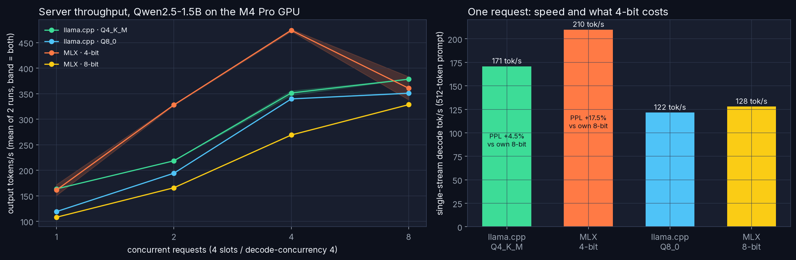</p>
<p align="center"><sub><b>Figure 5.</b> Left: <code>llama-server -np 4</code> against <code>mlx_lm.server --decode-concurrency 4</code>, mean of two runs (band: both runs), EOS respected on both. Right: one request, 512-token prompt, 128 tokens; the label shows how much perplexity each 4-bit format loses against the same engine's 8-bit.</sub></p>

| | llama.cpp Q4_K_M | MLX 4-bit | llama.cpp Q8_0 | MLX 8-bit |
|---|---|---|---|---|
| Weights file | 1,066 MiB | 828 MiB | 1,807 MiB | 1,564 MiB |
| Decode, one request, 512-token prompt | 171 tok/s | **210 tok/s** | 122 tok/s | 128 tok/s |
| Prefill, 4,096-token prompt | 2,010 tok/s | 2,131 tok/s | 2,086 tok/s | 2,252 tok/s |
| Server, 4 concurrent (mean of 2 runs) | 351 tok/s | **474 tok/s** | 340 tok/s | 269 tok/s |
| Server, 8 concurrent | 378 tok/s | 361 tok/s | 351 tok/s | 329 tok/s |
| Failed requests at 8 concurrent (2 runs) | 0 / 48 | 1 / 48 | 0 / 48 | 2 / 48 |
| Perplexity (ctx 512) | 24.69 ± 1.09 | 27.26 ± 1.19 | 23.63 ± 1.04 | 23.21 ± 1.01 |

Both engines got the same token ids for the single-request runs, and each point ran in a fresh
process. MLX's 4-bit is faster partly because its file is 22% smaller, and that shows in quality:
+17.5% perplexity against its own 8-bit, where Q4_K_M loses 4.5% against Q8_0. (The two 8-bit results are
within 2% of each other, but the perplexity code differs, so each 4-bit is compared with its own engine's 8-bit.)
Under load, MLX's 4-bit throughput fell from 4 to 8 concurrent requests, and 3 of 96 MLX requests at
8 concurrent failed on the client side (none for llama.cpp); the cause was not investigated. Files: `results/mlx_concurrency*.json`,
`results/ctx_curve.json`, `results/single_8bit.json`, `results/perplexity_mlx.json`;
[ADR 0004](docs/adr/0004-mlx-vs-llamacpp.md).

### Long context: 512 to 31k tokens

<p align="center">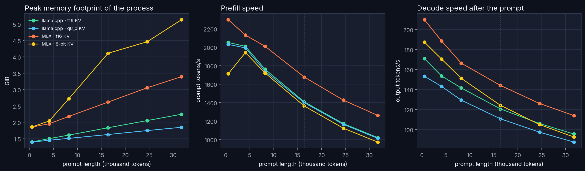</p>
<p align="center"><sub><b>Figure 6.</b> Qwen2.5-1.5B at 4 bits, one request, 128 generated tokens, one fresh process per point. Memory is the peak footprint from <code>/usr/bin/time -l</code>, which counts Metal buffers; llama.cpp runs without mmap so its weights are counted too. The dotted line marks 16k.</sub></p>

| Prompt tokens | llama.cpp f16 KV | llama.cpp q8_0 KV | MLX f16 KV | MLX 8-bit KV |
|---|---|---|---|---|
| 512 | 1.40 GiB · 171 tok/s | 1.40 GiB · 153 tok/s | 1.86 GiB · 210 tok/s | 1.86 GiB · 187 tok/s |
| 8,192 | 1.61 GiB · 142 tok/s | 1.51 GiB · 129 tok/s | 2.18 GiB · 166 tok/s | 2.72 GiB · 151 tok/s |
| 16,384 | 1.83 GiB · 121 tok/s | 1.63 GiB · 111 tok/s | 2.62 GiB · 144 tok/s | 4.11 GiB · 124 tok/s |
| 31,744 | 2.25 GiB · 96 tok/s | **1.85 GiB** · 87 tok/s | 3.40 GiB · **114 tok/s** | 5.14 GiB · 93 tok/s |
| Prefill time at 31,744 | 31.1 s | 31.3 s | **25.2 s** | 32.6 s |

Peak footprint and decode speed per cell. llama.cpp grows by its KV cache and little else (+866 MiB
from 512 to 31,744 tokens; the server logs 875 MiB of KV), so the q8_0 cache halves the growth for an
8-10% decode cost. MLX grows by more than its cache (+1,577 MiB) because prefill holds temporary
buffers. Its 8-bit KV cache (`kv_bits=8`) made the peak *larger* in this version. The long prompts
repeat the 38 KB documentation text, which does not change the compute. File: `results/ctx_curve.json`;
[ADR 0006](docs/adr/0006-long-context-memory.md).

### Speculative decoding

<p align="center">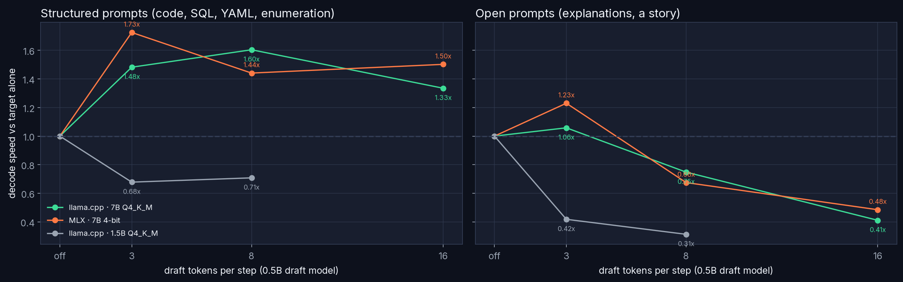</p>
<p align="center"><sub><b>Figure 7.</b> Decode speed with a Qwen2.5-0.5B draft model relative to the target alone, greedy, 256 tokens, one request at a time. Left: code, SQL, JSON-to-YAML and an enumeration. Right: explanations and a short story.</sub></p>

| Target (alone) | Draft tokens | Structured | Open | Output tokens from the draft |
|---|---|---|---|---|
| llama.cpp 7B Q4_K_M (51.7 tok/s) | 3 / 8 / 16 | 1.48x / **1.60x** / 1.33x | 1.06x / 0.75x / 0.41x | 66% / 76% / 78% |
| MLX 7B 4-bit (59.5 tok/s) | 3 / 8 / 16 | **1.73x** / 1.44x / 1.50x | 1.23x / 0.68x / 0.49x | 66% / 77% / 79% |
| llama.cpp 1.5B Q4_K_M (169.9 tok/s) | 3 / 8 | 0.68x / 0.71x | 0.42x / 0.31x | 66% / 77% |

A draft helps when the target is much larger than the draft and the text is predictable. With a
1.5B target, the extra draft passes cost more than they save, even at 86% draft acceptance on
structured prompts. Long drafts on open text waste work: 16 draft tokens made the 7B runs 2.0-2.4x
slower. Two practical findings: llama.cpp needs `--spec-type draft-simple` (with only `-md` the draft
is loaded and never used; our first run measured exactly 1.00x), and greedy output with a draft was
not always byte-identical to the target alone (llama.cpp: 5 of 8 prompts diverged after 500-1,400
identical characters; MLX: 0-3 of 8), because batched verification rounds differently from
single-token decoding. Files: `results/spec_*.json`; [ADR 0005](docs/adr/0005-speculative-decoding.md).

### Why speculative output differs from the target alone

<p align="center">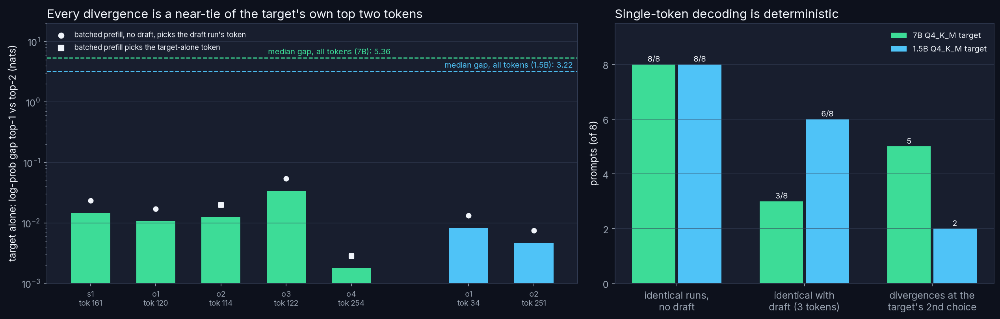</p>
<p align="center"><sub><b>Figure 8.</b> Left: at the first token where the draft run differs, how close the target's own top two tokens were (log scale); dashed lines are the median gap over all generated tokens. Markers: what the target alone picks when the same prefix is fed as one batch. Right: identical outputs out of 8 prompts. llama.cpp b12359, Metal, greedy, 256 tokens, draft Qwen2.5-0.5B Q8_0 with 3 draft tokens; MacBook Air M5.</sub></p>

The earlier run found greedy text with a draft model differing from the target alone on 5 of 8
prompts (7B). `bench/spec_mismatch.py` repeats that comparison and asks why:

| Check (7B target / 1.5B target) | 7B Q4_K_M | 1.5B Q4_K_M |
|---|---|---|
| Target alone, run twice: identical | 8/8 | 8/8 |
| With a 3-token draft: identical to target alone | 3/8 | 6/8 |
| First differing token (index in the output) | 114-254 | 34, 251 |
| Draft run's token is the target's own 2nd choice | 5/5 | 2/2 |
| Top-1 vs top-2 log-prob gap at that token | 0.002-0.034 nats | 0.005, 0.008 nats |
| Median gap over all generated tokens | 5.36 nats | 3.22 nats |
| Share of all tokens with a gap below 0.1 nats | 2.4% | 2.9% |
| Target alone, same prefix as one batch, picks the draft run's token | 3/5 | 2/2 |

**Cause.** Single-token decoding is deterministic, so the difference is not random. Every divergence
sits on a near-tie (in the lowest 1.2% of gaps for that run) and the draft run always picks the
target's second choice. With a draft, the target scores 4 tokens in one batch; without, it scores
one. The batched and single-token Metal kernels sum in a different order, so the logits differ in
the last bits, which is enough to flip a tie. The target alone shows the same flip with no draft
model involved when the prefix is prefilled as a batch (3 of 5 at 7B, 2 of 2 at 1.5B); the other two
cases depend on the exact batch shape (a whole prompt is not a 4-token verification batch). This is
expected behaviour of floating-point batching, not a correctness bug in speculative decoding: the
output is always a sequence the target itself scores as (nearly) best. Byte-identical output needs
batch-invariant kernels, which llama.cpp does not offer on Metal. Files:
`results/air/spec_mismatch_*.json`.

### MacBook Air M5 vs M4 Pro

<p align="center">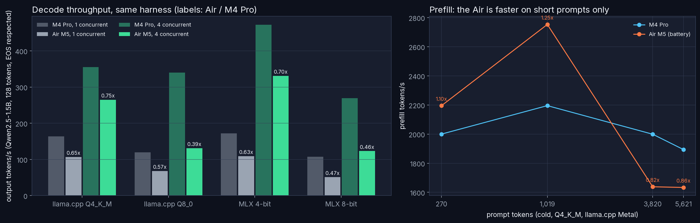</p>
<p align="center"><sub><b>Figure 9.</b> Left: output tokens/s on both machines with the same harness (Qwen2.5-1.5B, 128 tokens, EOS respected); labels are Air / M4 Pro. Right: cold prefill with llama.cpp on Metal, Q4_K_M. Air: Apple M5, 10-core GPU, 24 GB, on battery; same llama.cpp build number.</sub></p>

| Qwen2.5-1.5B | M4 Pro | Air M5 | Air / M4 Pro |
|---|---:|---:|---:|
| llama.cpp Q4_K_M, 1 request (tok/s) | 164 | 107 | 0.65x |
| llama.cpp Q4_K_M, 4 concurrent | 356 | 265 | 0.75x |
| llama.cpp Q8_0, 1 request | 119 | 68 | 0.57x |
| MLX 4-bit, 4 concurrent | 472 | 331 | 0.70x |
| Prefill, ~1k-token prompt (prompt tok/s) | 2,196 | 2,753 | 1.25x |
| Prefill, 3.8k-token prompt | 1,999 | 1,638 | 0.82x |

Decode on one request tracks memory bandwidth: Apple lists 153 GB/s for the M5 and 273 GB/s for the
M4 Pro (0.56x), close to the measured 0.57x for Q8_0 (a specification, not measured here). Short
prefills are compute-bound and the Air's newer GPU wins; on long prompts it falls behind, which fits
a fanless machine holding a lower sustained clock, but the clock was not measured. The decisions in
ADR 0003-0005 hold on the Air: Q4_K_M is the faster format on Metal, and 4 concurrent requests
saturate 4 slots (TTFT at 8 concurrent: 1.8 s Q4_K_M). Files: `results/air/`.

## Decisions

| ADR | Decision |
|---|---|
| [0001](docs/adr/0001-what-is-benchmarked.md) | Benchmark servers that run here; no borrowed numbers |
| [0002](docs/adr/0002-methodology.md) | Methodology: streaming client, fixed output length, cold prompts |
| [0003](docs/adr/0003-quantization-and-kv-defaults.md) | Serving defaults: Q4_K_M on GPU, Q8_0 on CPU, q8_0 KV for long contexts, concurrency = slots, prompt cache on |
| [0004](docs/adr/0004-mlx-vs-llamacpp.md) | Comparing MLX with llama.cpp: same tokens, same GPU, quality checked next to speed |
| [0005](docs/adr/0005-speculative-decoding.md) | Speculative decoding only for a large target and predictable output |
| [0006](docs/adr/0006-long-context-memory.md) | Long context: measure the process, not the formula |

## Enterprise mapping

| This repo | Enterprise equivalent | Notes |
|---|---|---|
| llama.cpp `llama-server` | vLLM, NVIDIA Triton / TensorRT-LLM, Cloudera AI Inference Service | Same OpenAI API; the load generator runs unchanged against vLLM |
| `-np` slots | vLLM `--max-num-seqs`, continuous batching | Sets the concurrency at which TTFT starts to climb |
| KV q8_0 + flash attention | vLLM `--kv-cache-dtype fp8`, paged attention | Trade KV memory for context length or batch size |
| Prompt cache | vLLM automatic prefix caching | Big win for fixed system prompts and RAG templates |
| GGUF Q4_K_M / Q8_0 | AWQ, GPTQ, FP8 checkpoints | Quantization choice is hardware specific: measure it |
| MLX on a Mac | Apple-silicon edge or developer inference | Fast at 4-bit, check the quality loss before choosing it |
| Draft-model speculative decoding | vLLM / TensorRT-LLM speculative decoding, EAGLE, Medusa | Gains depend on target/draft size ratio and on how predictable the output is |
| `bench/loadgen.py` | GuideLLM, vLLM `benchmark_serving.py`, k6 | Same metrics: TTFT, ITL, output tok/s, req/s |
| `results/*.json` + charts | Capacity-planning sheet, Grafana | `--metrics` exposes Prometheus counters on both servers |

## Quickstart

Requirements: macOS on Apple Silicon with Homebrew `llama.cpp` (for Metal), Docker (Colima or Docker
Desktop) for the CPU path, [uv](https://docs.astral.sh/uv/), ~7 GB of disk for the base models and
another ~12 GB for the MLX, 7B and draft models.

```bash
git clone https://github.com/masterfabric/masterfabric-llm-serving-bench && cd masterfabric-llm-serving-bench
make venv          # .venv with pinned httpx, numpy, matplotlib, pillow
make models        # GGUF files into ~/.cache/mf-models (not into git)
make prefill       # or: concurrency, kvcache, promptcache, perplexity, bench (all, ~25 min)
make venv-mlx      # add mlx and mlx-lm (Apple Silicon)
make models-extra  # 7B and 0.5B GGUF (sha256-checked) and the MLX models
make mlx           # MLX vs llama.cpp, long-context curve, speculative decoding (~20 min)
make mlx-ppl       # perplexity of the MLX weights
make charts        # docs/images/*.png and docs/hero.png from results/*.json
make clean-servers # stop anything the benchmarks started
```

Servers bind to `127.0.0.1:58080` (Metal), `127.0.0.1:58081` (CPU), `127.0.0.1:58082` (MLX) and
`127.0.0.1:58083-58084` (long-context and speculative runs) only. To benchmark another
OpenAI-compatible server, point the client at it:

```bash
.venv/bin/python bench/loadgen.py --url http://HOST:PORT --label my-server --levels 1,2,4,8 --out results/my_server.json
```

## Limitations

- **No GPU server and no vLLM run.** The lab has no NVIDIA GPU. "GPU" here means the Apple M4 Pro
  through Metal. The load generator speaks the OpenAI API, so vLLM numbers can be added without code
  changes, but none are claimed.
- **The MacBook Air ran on battery, once.** On 2026-11-23 the Air M5 was reachable and the M4 Pro
  was not, so the Air runs and the mismatch study were done there: battery 43% → 21%, low power mode
  off, one run per configuration. Q8_0 at 4 concurrent gave 213 tok/s in the first sweep
  (`ignore_eos`) and 131 tok/s in the MLX-comparison sweep 15 minutes later (EOS respected); the
  difference was not explained, so the Air numbers are indicative. The tools, models and repo copy
  lived in one temporary folder on the Air and were deleted afterwards; the CPU container and
  long-context runs were not repeated there.
- **Mismatch study on one machine and one build.** The cause (batched vs single-token kernels) is
  shown by the batched-prefill test and the near-tie gaps, not by reading the Metal kernels; the 7B
  mismatch study ran on the Air, the original speed results on the M4 Pro. Decode speeds in
  `spec_mismatch_*.json` include the cost of returning top-2 probabilities and are not benchmarks.
- **Ollama not measured.** It is installed but its server was not running, and this repo does not
  start or change long-lived services on the machine.
- **One small model, short runs, single repetition.** Qwen2.5-1.5B only; 8-24 requests per level;
  each configuration ran once except the repeated CPU check. No confidence intervals for latency.
- **Laptop conditions.** Other apps, thermal state and a model download in the background during
  the first runs were not controlled.
- **Concurrency sweep uses short prompts** (~48 tokens), which llama.cpp may serve partly from the
  prompt cache; its TTFT measures queueing. Prefill is measured separately with cold prompts.
- **KV buffer sizes are computed**, not read from the server; RSS includes weights and compute buffers.
- **The two llama.cpp builds differ** (12359 on the host, 12464 in the container).
- **MLX vs llama.cpp is not bit-for-bit matched.** MLX 4-bit and Q4_K_M differ in size and quality
  (perplexity is reported next to speed), and the MLX server cannot ignore EOS, so its server runs
  respect EOS on both engines (the older concurrency table above used `ignore_eos`).
- **Speculative decoding** was measured with one request at a time and 8 prompts; with many
  concurrent users on a GPU server the gain is usually smaller. Output with a draft was not always
  identical to the target alone.
- **Long-context curve**: one request per point, no repetitions; the 31k prompts repeat the same
  documentation text. The MLX 8-bit KV memory increase was observed, not explained.
- **Perplexity on 38 KB of text** is a coarse quality signal, not a task evaluation. The
  Q4_K_M/Q8_0 difference is within the error bars.
- **The Q8_0 > Q4_K_M result on CPU was not profiled.** It was reproduced, but the cause (CPU kernel
  differences between the formats on ARM) is a hypothesis.

## Roadmap

- vLLM on an NVIDIA node with the same client, and FP8 KV cache vs f16.
- Ollama and llama.cpp side by side on the same GGUF file.
- Speculative decoding under concurrency, and n-gram / EAGLE drafts instead of a draft model.
- The Air M5 runs on mains power with repetitions, and a CPU-only comparison on the Air.
- MLX with a matched-quality 4-bit (for example group size 32) to compare at equal perplexity.
- Longer runs with repetitions and confidence intervals; power draw per token on Metal.
- 14B and larger models to find the memory limit of a 24 GB machine (7B is now measured).

## Repository layout

```
bench/       loadgen.py, run_matrix.sh, run_mlx.sh, ctx_curve.py, spec_decode.py, mlx_perplexity.py,
             get_models.sh, get_models_extra.sh, make_charts.py, make_diagrams.py, make_hero.py
bench/text/  documentation text for long prompts and perplexity
results/     measured results (JSON); raw server logs stay local in results/raw/
docs/        hero, images, ADRs, TIMELINE
```

## License

AGPL-3.0, see [LICENSE](LICENSE). Additional attribution and trademark terms and third-party
licenses (llama.cpp MIT, MLX and mlx-lm MIT, Qwen2.5 weights Apache-2.0, not redistributed) are listed in [NOTICE](NOTICE).
See also [CONTRIBUTING](CONTRIBUTING.md), [CODE_OF_CONDUCT](CODE_OF_CONDUCT.md) and [SECURITY](SECURITY.md).
