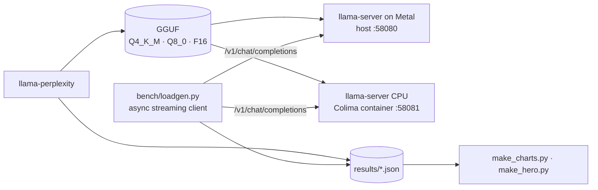

<p align="center"></p>

# MasterFabric · LLM Serving Bench

Measured LLM serving benchmarks on servers that actually ran: aggregate throughput, time to first token
(TTFT) and inter-token latency (ITL) against concurrency, prefill cost against prompt length,
weight quantization (Q4_K_M, Q8_0, F16), KV-cache quantization and prompt-cache reuse.
llama.cpp on the Apple M4 Pro GPU (Metal) is compared with the same server in a CPU-only container.

Every number in this README comes from a file in [`results/`](results/), written by the scripts in
[`bench/`](bench/). Values that are computed rather than measured say so.

> Part of the MasterFabric data and AI portfolio. The serving defaults chosen here feed
> [masterfabric-onprem-llm-stack](https://github.com/masterfabric/masterfabric-onprem-llm-stack).

## Contents

- [Key results](#key-results) · [Setup](#setup) · [Results](#results) · [Decisions (ADRs)](#decisions)
- [Enterprise mapping](#enterprise-mapping) · [Quickstart](#quickstart) · [Limitations](#limitations) · [Roadmap](#roadmap)

## Key results

| | Metal GPU (host) | CPU container (6 vCPU) |
|---|---|---|
| Peak output throughput, Q4_K_M (4 concurrent) | **381 tok/s** | 184 tok/s |
| Peak output throughput, Q8_0 (4 concurrent) | 358 tok/s | **328 tok/s** |
| Single-stream decode, Q4_K_M (ITL p50) | 5.9 ms/token (161 tok/s) | 8.6 ms/token (110 tok/s) |
| Prefill, Q4_K_M, ~1k-token prompt | 2,196 prompt tok/s | 330 prompt tok/s |
| TTFT for a 3.8k-token prompt, cold | 1.91 s | 13.83 s |

- **Concurrency should equal the slot count.** With 4 slots, throughput peaks at 4 concurrent
  requests; at 8, half the requests wait for a slot and TTFT p50 jumps from ~14 ms to 1.5-2.9 s.
- **Q8_0 is the better CPU format on this machine.** 328 vs 184 tok/s at 4 concurrent, reproduced in a
  second run (335 vs 181). On Metal, Q4_K_M is slightly faster.
- **Q4_K_M costs little quality.** Perplexity 24.69 ± 1.09 vs 23.63 ± 1.04 for Q8_0 (F16: 23.62 ± 1.04, so Q8_0 is indistinguishable from F16),
  for a 41% smaller file.
- **A q8_0 KV cache halves KV memory at the same speed.** At 32k context: 896 → 476 MiB KV buffer
  (computed), server RSS 2,747 → 2,043 MiB (measured), 38.2 vs 37.9 tok/s.
- **The prompt cache turns a 1.89 s prefill into 13 ms** for a repeated 4k-token prompt, and costs
  nothing on the cold request (1.888 s vs 1.891 s).

## Setup

<p align="center"></p>
<p align="center"><sub><b>Figure 1.</b> One load generator, one OpenAI-compatible API, two execution paths on the same laptop.</sub></p>



| | |
|---|---|
| Machine | Apple M4 Pro, 14 cores, 24 GB unified memory, macOS 27.2.1 |
| Metal server | Homebrew llama.cpp 1.0.0 (build 12359), `-ngl 99 -np 4 -c 16384` |
| CPU server | `ghcr.io/ggml-org/llama.cpp:server-b12464` in Colima (6 vCPU, 10 GB), `-t 6 -np 4 -c 16384` |
| Model | Qwen2.5-1.5B-Instruct GGUF (Q4_K_M 1,066 MiB, Q8_0 1,807 MiB, F16 3,396 MiB) |
| Client | [`bench/loadgen.py`](bench/loadgen.py): httpx, streaming, `ignore_eos`, 128 output tokens, temperature 0 |

How each metric is measured, and what was not controlled, is in [ADR 0002](docs/adr/0002-methodology.md).

## Results

### Throughput and latency against concurrency

<p align="center"></p>
<p align="center"><sub><b>Figure 2.</b> 1, 2, 4 and 8 concurrent requests against 4 server slots. Short (~48-token) prompts, so TTFT here measures queueing, not prefill.</sub></p>

| Backend · weights | 1 | 2 | 4 | 8 | ITL p50 at 4 | TTFT p50 at 8 |
|---|---|---|---|---|---|---|
| Metal · Q4_K_M | 161 | 229 | **381** | 327 | 9.9 ms | 1.53 s |
| Metal · Q8_0 | 120 | 214 | 358 | 303 | 11.4 ms | 1.59 s |
| CPU · Q4_K_M | 110 | 138 | 184 | 182 | 20.7 ms | 2.88 s |
| CPU · Q8_0 | 106 | 152 | 328 | 312 | 11.7 ms | 1.68 s |

Output tokens/s, summed over all requests in flight. Files: `results/concurrency_*.json`, repeat run in `results/repeat_cpu.json`.

### Prefill cost against prompt length

<p align="center"></p>
<p align="center"><sub><b>Figure 3.</b> Cold prompts cut from real documentation, prompt cache off, Q4_K_M, 32k context.</sub></p>

| Prompt tokens | Metal TTFT | Metal prefill | CPU TTFT | CPU prefill |
|---|---|---|---|---|
| 270 | 0.135 s | 2,000 tok/s | 0.768 s | 352 tok/s |
| 1,019 | 0.464 s | 2,196 tok/s | 3.091 s | 330 tok/s |
| 3,820 | 1.911 s | 1,999 tok/s | 13.834 s | 276 tok/s |
| 5,621 | 2.968 s | 1,894 tok/s | not run | |

The GPU prefills 6-7× faster than the CPU container, and the gap grows with the prompt: CPU prefill
slows down as attention over a longer context starts to dominate. For RAG with 4k-token contexts, a
CPU-only node adds ~14 s before the first token. File: `results/prefill.json`.

### KV cache, prompt cache and quantization quality

<p align="center"></p>
<p align="center"><sub><b>Figure 4.</b> Left: f16 vs q8_0 KV cache. Middle: TTFT for a repeated 4k-token prompt. Right: perplexity on 38 KB of lab documentation.</sub></p>

| KV cache type (32k ctx, flash attention) | KV buffer (computed) | Server RSS (measured) | Output tok/s | TTFT p50 | ITL p50 |
|---|---|---|---|---|---|
| f16 | 896 MiB | 2,747 MiB | 38.2 | 5.55 s | 13.7 ms |
| q8_0 | 476 MiB | 2,043 MiB | 37.9 | 4.54 s | 13.6 ms |

The KV buffer is computed from the model shape: 28 layers × 2 KV heads × 128 dims × (K + V) =
14,336 values per token, × 32,768 tokens × 2 bytes (f16) or 34/32 bytes (q8_0). The quiet server
log did not print buffer sizes, so the measured figure is the server's resident memory after the run.

| Prompt cache | 1st request TTFT | Repeat TTFT |
|---|---|---|
| off (`cache_prompt: false`) | 1.891 s | 1.885 s |
| on (default) | 1.888 s | **0.013 s** |

| Weights | File | Perplexity (ctx 512) |
|---|---|---|
| Q4_K_M | 1,066 MiB | 24.69 ± 1.09 |
| Q8_0 | 1,807 MiB | 23.63 ± 1.04 |
| F16 | 3,396 MiB | 23.62 ± 1.04 |

Files: `results/kvcache.json`, `results/promptcache.json`, `results/perplexity.json`.

## Decisions

| ADR | Decision |
|---|---|
| [0001](docs/adr/0001-what-is-benchmarked.md) | Benchmark servers that run here; no borrowed numbers |
| [0002](docs/adr/0002-methodology.md) | Methodology: streaming client, fixed output length, cold prompts |
| [0003](docs/adr/0003-quantization-and-kv-defaults.md) | Serving defaults: Q4_K_M on GPU, Q8_0 on CPU, q8_0 KV for long contexts, concurrency = slots, prompt cache on |

## Enterprise mapping

| This repo | Enterprise equivalent | Notes |
|---|---|---|
| llama.cpp `llama-server` | vLLM, NVIDIA Triton / TensorRT-LLM, Cloudera AI Inference Service | Same OpenAI API; the load generator runs unchanged against vLLM |
| `-np` slots | vLLM `--max-num-seqs`, continuous batching | Sets the concurrency at which TTFT starts to climb |
| KV q8_0 + flash attention | vLLM `--kv-cache-dtype fp8`, paged attention | Trade KV memory for context length or batch size |
| Prompt cache | vLLM automatic prefix caching | Big win for fixed system prompts and RAG templates |
| GGUF Q4_K_M / Q8_0 | AWQ, GPTQ, FP8 checkpoints | Quantization choice is hardware specific: measure it |
| `bench/loadgen.py` | GuideLLM, vLLM `benchmark_serving.py`, k6 | Same metrics: TTFT, ITL, output tok/s, req/s |
| `results/*.json` + charts | Capacity-planning sheet, Grafana | `--metrics` exposes Prometheus counters on both servers |

## Quickstart

Requirements: macOS on Apple Silicon with Homebrew `llama.cpp` (for Metal), Docker (Colima or Docker
Desktop) for the CPU path, [uv](https://docs.astral.sh/uv/), ~7 GB of disk for the models.

```bash
git clone https://github.com/masterfabric/masterfabric-llm-serving-bench && cd masterfabric-llm-serving-bench
make venv          # .venv with pinned httpx, numpy, matplotlib, pillow
make models        # GGUF files into ~/.cache/mf-models (not into git)
make prefill       # or: concurrency, kvcache, promptcache, perplexity, bench (all, ~25 min)
make charts        # docs/images/*.png and docs/hero.png from results/*.json
make clean-servers # stop anything the benchmarks started
```

Servers bind to `127.0.0.1:58080` (Metal) and `127.0.0.1:58081` (CPU) only. To benchmark another
OpenAI-compatible server, point the client at it:

```bash
.venv/bin/python bench/loadgen.py --url http://HOST:PORT --label my-server --levels 1,2,4,8 --out results/my_server.json
```

## Limitations

- **No GPU server and no vLLM run.** The lab has no NVIDIA GPU. "GPU" here means the Apple M4 Pro
  through Metal. The load generator speaks the OpenAI API, so vLLM numbers can be added without code
  changes, but none are claimed.
- **No remote machines.** The brief allowed read-only benchmarking of other tailnet machines. On
  2026-11-21 this laptop was the only online node (all others last seen 1-74 days earlier), so none
  were benchmarked or contacted.
- **Ollama not measured.** It is installed but its server was not running, and this repo does not
  start or change long-lived services on the machine.
- **One small model, short runs, single repetition.** Qwen2.5-1.5B only; 8-24 requests per level;
  each configuration ran once except the repeated CPU check. No confidence intervals for latency.
- **Laptop conditions.** Other apps, thermal state and a model download in the background during
  the first runs were not controlled.
- **Concurrency sweep uses short prompts** (~48 tokens), which llama.cpp may serve partly from the
  prompt cache; its TTFT measures queueing. Prefill is measured separately with cold prompts.
- **KV buffer sizes are computed**, not read from the server; RSS includes weights and compute buffers.
- **The two llama.cpp builds differ** (12359 on the host, 12464 in the container).
- **Perplexity on 38 KB of text** is a coarse quality signal, not a task evaluation. The
  Q4_K_M/Q8_0 difference is within the error bars.
- **The Q8_0 > Q4_K_M result on CPU was not profiled.** It was reproduced, but the cause (CPU kernel
  differences between the formats on ARM) is a hypothesis.

## Roadmap

- vLLM on an NVIDIA node with the same client, and FP8 KV cache vs f16.
- Ollama and llama.cpp side by side on the same GGUF file.
- Speculative decoding (draft model) and its effect on ITL.
- Longer runs with repetitions and confidence intervals; power draw per token on Metal.
- Larger models (7B, 14B) to find the memory limit of a 24 GB machine.

## Repository layout

```
bench/       loadgen.py, run_matrix.sh, get_models.sh, make_charts.py, make_diagrams.py, make_hero.py
bench/text/  documentation text for long prompts and perplexity
results/     measured results (JSON); raw server logs stay local in results/raw/
docs/        hero, images, ADRs, TIMELINE
```

## License

AGPL-3.0, see [LICENSE](LICENSE). Additional attribution and trademark terms and third-party
licenses (llama.cpp MIT, Qwen2.5 weights Apache-2.0, not redistributed) are listed in [NOTICE](NOTICE).
See also [CONTRIBUTING](CONTRIBUTING.md), [CODE_OF_CONDUCT](CODE_OF_CONDUCT.md) and [SECURITY](SECURITY.md).
